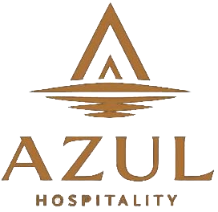
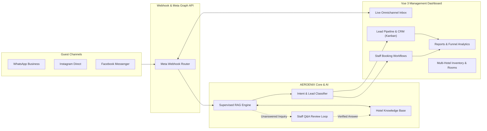

<p align="center">
  
</p>

<h1 align="center">AEROENIX — Next-Gen Hospitality & AI Omnichannel Platform</h1>

<p align="center">
  <strong>Intelligent AI Guest Inquiries, Autonomous RAG Assistant, Omnichannel Unified Inbox, Lead Pipeline CRM, and Real-Time Analytics Dashboard.</strong>
</p>

<p align="center">
  <a href="https://aeroenix.vercel.app"></a>
  <a href="LICENSE"></a>
  
  
  
  
  
</p>

---

## 🌟 Overview

**AEROENIX** (formerly Azul) is an enterprise-grade AI customer service and operational management platform engineered specifically for luxury hotels, resorts, and hospitality groups. 

The platform bridges real-time guest communication across **WhatsApp Business, Facebook Messenger, and Instagram Direct** with an autonomous **Retrieval-Augmented Generation (RAG)** knowledge engine, a visual **Lead Pipeline & CRM**, staff-confirmed booking workflows, and deep operational analytics.

### 🌐 Live Production Demo
Access the live deployment here: **[aeroenix.vercel.app](https://aeroenix.vercel.app)**

---

## 🏗️ Architecture & High-Level Flow



---

## 🚀 Key Feature Highlights

### 🤖 1. Autonomous AI RAG Engine & Human-in-the-Loop
- **Semantic Retrieval**: Answers guest inquiries regarding amenities, dining, check-in policies, and room availability using vector similarity over hotel-curated knowledge.
- **Confidence Scoring & Safe Fallbacks**: Low-confidence or unverified answers are automatically flagged into the **Staff Q&A** queue for employee verification before reaching the guest.
- **Continuous Learning**: Approved answers automatically update the hotel's AI knowledge base with zero retraining downtime.

### 💬 2. Unified Omnichannel Live Inbox
- **Multi-Platform Convergence**: WhatsApp, Facebook Messenger, and Instagram Direct conversations appear in a unified, synchronized feed.
- **AI Handover / Staff Takeover**: Seamlessly transition between autonomous AI mode and live staff intervention with real-time presence indicators.
- **Guest Profiles & Context**: Instantly inspect guest phone numbers, classification tags, conversation histories, and previous bookings alongside the chat thread.

### 🎯 3. CRM & Lead Pipeline (Kanban & Table Views)
- **Automatic Lead Classification**: Inquiries are tagged into **Cold**, **Warm**, or **Hot** leads based on conversational purchase intent and booking indicators.
- **AI Lead Scoring**: Quantifiable 0–100 scores highlighting guest intent.
- **Interactive CRM Slide-Over Sheet**: Review guest inquiries, update classifications, assign sales team tags, and inspect linked conversation transcripts directly without leaving the view.
- **Dual View Modes**: Switch between high-level visual Kanban columns and sortable, filterable tabular data.

### 📊 4. Reports & Funnel Analytics
- **Conversion Progression Funnel**: Visualize end-to-end guest conversion rates from `Total Conversations` ➔ `Leads Generated` ➔ `Bookings Created` ➔ `Confirmed Bookings`.
- **AI Performance KPIs**: Track Average AI Response Latency, Guest Satisfaction Scores, Bot Mistake Rates, and Staff Handover Percentages.
- **One-Click Data Export**: Direct streaming export of customer, booking, and conversation datasets to **Excel/CSV** with UTF-8 BOM encoding.

### 🏨 5. Multi-Hotel & Room Management
- **Property Scoping**: Manage multiple hotels, resorts, and branches under a single master organization with role-scoped isolation.
- **Room Types & Inventory**: Control room categories, capacities, base pricing, active operational status, and real-time availability.

### 🔒 6. Enterprise RBAC & Security
- **Granular Permissions**: Role-based access control (RBAC) with fine-grained permission checks down to route and action levels.
- **Audit Trails**: Built-in Activity Logs recording logins, role updates, bookings status changes, and staff interactions.

### 🌍 7. First-Class Bilingual & RTL Support
- Instant, zero-reload locale toggling between **English** and **Arabic (العربية)**.
- Full right-to-left (**RTL**) layout mirroring with typography powered by Bahij TheSansArabic.

---

## 💻 Tech Stack & Tooling

| Domain | Technology / Library |
| :--- | :--- |
| **Framework** | [Vue 3 (Composition API)](https://vuejs.org/) + `<script setup lang="ts">` |
| **Language** | [TypeScript 5.8](https://www.typescriptlang.org/) with strict type checking |
| **Build & Tooling** | [Vite 6](https://vite.dev/) + [Bun](https://bun.sh/) runtime |
| **Styling & Design System** | [Tailwind CSS v4](https://tailwindcss.com/) + custom Glassmorphic Design System (`@/components/uic`) |
| **Headless UI Primitives**| [Radix Vue](https://www.radix-vue.com/) / [shadcn-vue](https://shadcn-vue.com/) |
| **State Management** | [Pinia 3](https://pinia.vuejs.org/) |
| **Async Server State** | [TanStack Vue Query 5](https://tanstack.com/query/latest) (smart caching, background refetching) |
| **Routing** | [Vue Router 4](https://router.vuejs.org/) (scoped guards, permission-aware navigation) |
| **Internationalization** | [Vue I18n 9](https://vue-i18n.intlify.dev/) (Composition API, lazy namespaces, RTL support) |
| **Icons** | [Hugeicons Vue](https://hugeicons.com/) & [Lucide Vue Next](https://lucide.dev/) |
| **Data Visualization** | [Vue3 ApexCharts](https://apexcharts.com/) |
| **Form Validation** | [Vee-Validate 4](https://vee-validate.logaretm.com/) + [Zod](https://zod.dev/) |
| **Testing** | [Vitest](https://vitest.dev/) + `@testing-library/vue` |
| **Component Workbench** | [Histoire](https://histoire.dev/) (Storybook alternative for Vite) |
| **Image Processing** | Python scripts (Pillow) with un-premultiplied alpha antialiasing |

---

## 📁 Repository Structure

```text
AEROENIX_FRONTEND/
├── .github/                 # GitHub CI/CD workflows and issue templates
├── docs/                    # VitePress developer documentation
├── public/                  # Static assets, PWA icons, and brand graphics
│   ├── logo-sidebar.png     # Full vertical brand logo (Emblem + AZUL underneath)
│   ├── logo-emblem.png      # High-res transparent emblem mark
│   ├── favicon.svg          # Modern vector SVG favicon
│   └── pwa-512x512.png      # PWA application icons
├── scripts/                 # Development and build automation tools
│   ├── process_logo.py      # Python script for alpha background removal & logo generation
│   ├── scaffold-module/     # CLI generator for instant CRUD module scaffolding
│   ├── i18n-prep.ts         # Bilingual locale synchronization and validation
│   └── remove-module/       # Clean module remover
├── src/
│   ├── assets/              # Global styles, fonts, and CSS utilities
│   ├── components/
│   │   ├── admin/           # Domain components (Leads, Reports, Knowledge, etc.)
│   │   ├── layout/          # AppSidebar, Navbar, Logo, AdminLayout, AuthLayout
│   │   └── uic/             # Atomic design system (Button, Dialog, Card, Skeleton, etc.)
│   ├── composables/         # Shared composables (useAuth, useDarkMode, useDetails, useForm)
│   ├── config/              # Navigation maps, searchable pages, API endpoints
│   ├── i18n/                # Localization configuration and locales (en/ar)
│   ├── modules/             # Self-registering feature modules (Hotels, Bookings, Leads, etc.)
│   ├── router/              # Route definitions, guards, and dynamic loaders
│   ├── services/            # Axios API services and query endpoints
│   ├── stores/              # Pinia global reactive stores
│   ├── types/               # TypeScript interface definitions and domain entities
│   └── views/               # Page views organized by admin domains
└── vite.config.ts           # Vite bundler, PWA, and build optimization config
```

---

## ⚡ Quick Start & Development

### Prerequisites
- **Node.js**: `v20.x` or later (or **Bun** `v1.1+` recommended)
- **Git**

### 1. Clone the repository
```bash
git clone https://github.com/ameenmv/AEROENIX.git
cd AEROENIX/AEROENIX_FRONTEND
```

### 2. Install dependencies
Using Bun (recommended):
```bash
bun install
```
*Or using npm/pnpm:*
```bash
npm install
```

### 3. Configure environment variables
Copy the example environment configuration:
```bash
cp .env.example .env
```
Key variables:
```ini
VITE_API_BASE_URL=https://api.yourdomain.com/api/v1
VITE_MOCK_AUTH=true          # Enables instant local development authentication
VITE_PWA_ENABLED=false
```

### 4. Start local development server
```bash
bun run dev
```
Open **`http://localhost:5173`** in your browser.

---

## 🛠️ CLI Tools & Automation Scripts

AEROENIX includes powerful built-in developer tools:

| Command | Description |
| :--- | :--- |
| `bun run dev` | Starts Vite dev server with instant HMR |
| `bun run build` | Runs full TypeScript validation (`vue-tsc -b`) and Vite production bundling |
| `bun run verify` | Full CI verification: linting, formatting, type check, build, and tests |
| `bun run make:module` | Interactive CLI generator to scaffold a complete typed CRUD module |
| `bun run unmake:module` | Safely removes an existing module and unregisters its routes |
| `bun run i18n:report` | Analyzes missing translation keys across English and Arabic dictionaries |
| `bun run i18n:clean` | Automatically removes unused translation keys from locales |
| `bun run test` | Executes unit and component tests via Vitest |
| `bun run histoire:dev` | Launches the interactive Histoire UI component playground |
| `python3 scripts/process_logo.py` | Extracts logo assets with alpha de-multiplication |

---

## 📜 License

This project is open-source software licensed under the **[MIT License](LICENSE)**.

---

<p align="center">
  Built with ❤️ for luxury hospitality by <strong><a href="https://github.com/ameenmv">Ameen</a></strong>.
</p>
